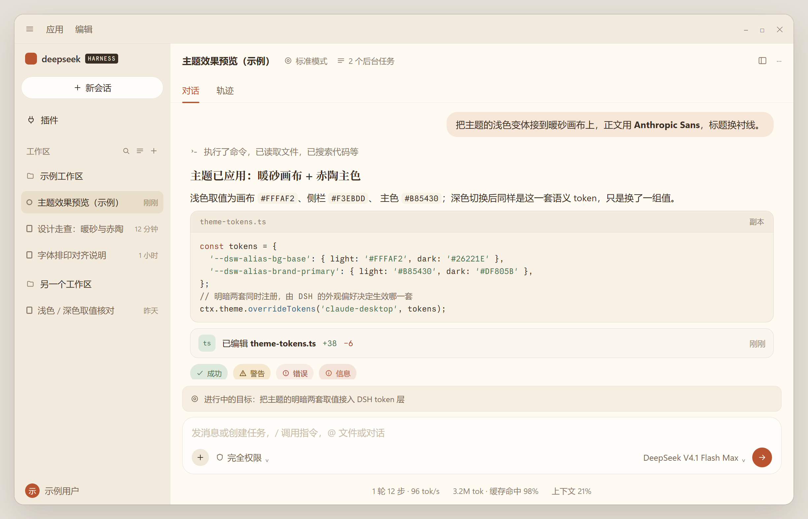
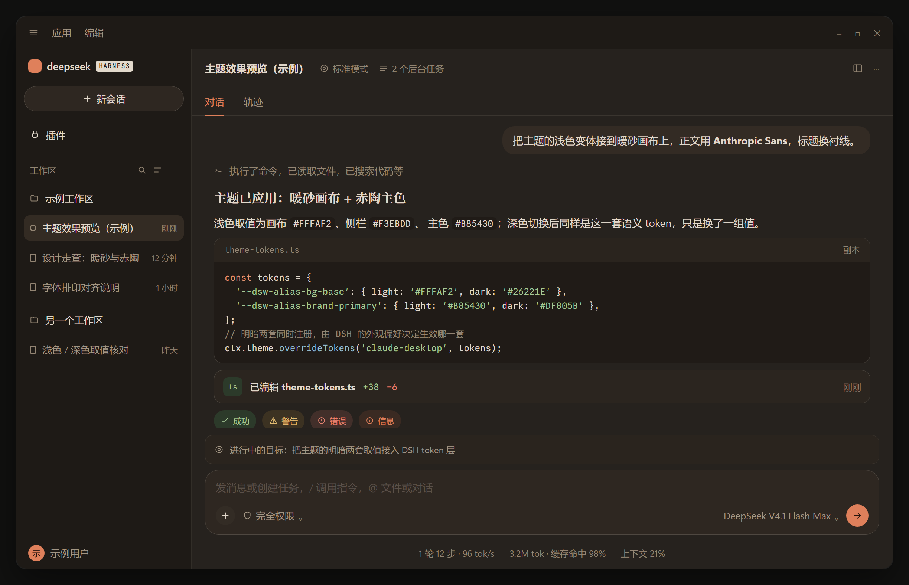
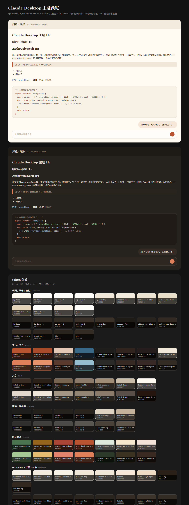

# @gongshiyun/dsh-theme-claude-desktop

参考 [Claude Desktop](https://claude.ai) 界面风格、以及仓库
[gongshiyun/openchamber-claude-desktop-theme](https://github.com/gongshiyun/openchamber-claude-desktop-theme)
（其配色又源自思源主题 [frostime/sy-theme-siyaude（砂源）](https://github.com/frostime/sy-theme-siyaude)）
为 **DeepSeek Harness（DSH）** 制作的客户端主题插件：

**暖砂画布 + 赤陶主色的浅色 / 深色双变体，外加一整套 Anthropic 字体排印层。**





> 上面两张是按 DSH 界面结构生成的**示意图**（`node tools/make-mock.mjs` → `docs/mock-*.html`），
> 文案全部虚构；颜色直接读 `lib/client.js` 的 token 表，所以不会和主题脱节。
> 真实截图会暴露工作区名与对话内容，因此仓库里不放。

---

## 特性

| | |
|---|---|
| **明暗双变体** | 两套取值同时注册，切换由 DSH 内置的「设置 → 通用 → 外观」（浅色 / 深色 / 跟随系统）驱动，插件本身不持有任何主题状态，也就不会和系统跟随、首屏 bootstrap、`theme-color` 元信息打架。 |
| **覆盖完整** | 共 133 个 token：90 个 `--dsw-alias-*` 语义 token **100% 覆盖**，外加 11 个 `--dsw-specific-*`、被组件直接消费的 18 个 `--dsw-static-*`、11 个 `--shiki-*` 语法色，以及字体排印层。 |
| **字体排印** | 界面 Anthropic Sans、标题 Anthropic Serif（H1–H3 衬线）、代码 Anthropic Mono；没装字体时优雅回退到 Segoe UI / Georgia / Cascadia Code，中文各自接思源与系统黑体、宋体。 |
| **字号设置兼容** | 标题字阶完整保留 `--dsh-content-font-delta` 增量，「设置 → 通用 → 内容字号」的 12–17px 调节照常生效。 |
| **零残留** | `overrideTokens` 返回的 disposer 挂在插件 fiber 上，禁用或卸载插件即刻回到内置配色。 |

---

## 安装

插件是一个普通的「双半边」npm 包：host 半边（`lib/index.js`）只提供一条可挂载的组合条目，
全部逻辑在 client 半边（`lib/client.js`）。

### 方式 A：按 bundle 依赖安装

```bash
cd "$DSH_HOME/profiles/desktop"        # Windows: C:\Users\<你>\.dsh\profiles\desktop
pnpm add @gongshiyun/dsh-theme-claude-desktop
```

本包的 `package.json` 里声明了 `dsh.bundle.patch`，profile 的 `dsh.profile.bundles`
引用它时会自动把条目插入组合树。

### 方式 B：只在某个 profile 里挂一条（本机验证用的方式）

在该 profile 的 `cordis.patch.yml` 顶层加上：

```yaml
- insert:
    - id: theme-claude-desktop
      name: '@gongshiyun/dsh-theme-claude-desktop'
```

保存后 DSH 会热加载这条 patch，无需重启。用 `Settings → 插件` 或
`plugin_manager list_plugins` 可以看到 `include:theme-claude-desktop` 处于 `active`。

### 方式 C：开发联调（本仓库直接当源码目录）

把仓库做成 junction / 软链放进 profile 的 `node_modules`，改 `lib/client.js`
即刻生效（DSH 的 client bundle 走文件监听 + HMR，浏览器端会自动重新加载该模块）：

```powershell
New-Item -ItemType Junction `
  -Path "$env:USERPROFILE\.dsh\profiles\desktop\node_modules\@gongshiyun\dsh-theme-claude-desktop" `
  -Target "D:\ai-code\dsh-claude-theme"
```

---

## 切换明暗

**设置 → 通用 → 外观** 里选「浅色 / 深色 / 跟随系统」即可 —— 这正是本插件选择
「token 覆盖层」而不是「注册两个第三方主题」的原因：第三方主题 id 不进内置外观设置的
schema，重启就会丢；而覆盖层直接跟着内置偏好走，明暗与跟随系统全部免费获得。

想恢复默认配色，把插件禁用（`Settings → 插件`）或从 `cordis.patch.yml` 里删掉那一行即可。

---

## 字体

三段字体栈都遵循「Anthropic 字体优先 → 本机近似字体 → 通用族」：

| 用途 | 首选 | 回退链 |
|---|---|---|
| 界面正文 | Anthropic Sans Text / Anthropic Sans | Styrene B → Segoe UI Variable Text → Segoe UI → PingFang SC → Microsoft YaHei UI → Noto Sans SC |
| 标题（H1–H3） | Anthropic Serif Text / Anthropic Serif | Copernicus → Tiempos Text → Georgia → Noto Serif SC → 宋体 |
| 代码 | Anthropic Mono | Cascadia Code → JetBrains Mono → SF Mono → Consolas |

**装了 Anthropic 字体就自动生效，不用改配置**。安装方式见
[matthieuhuguet/anthropic-fonts](https://github.com/matthieuhuguet/anthropic-fonts)；
Windows 上把 ttf 装到「为所有用户安装」后重启 DSH 即可。

想改成**全无衬线标题**，把 `lib/client.js` 里 `--dsw-font-markdown-h1/h2/h3` 三处
`FONT_SERIF` 换成 `FONT_SANS` 就行（这三条是 `font` 简写，必须整条重写，只改
`-font-family` 子 token 不会影响实际渲染 —— 这一点在文件头注释里有说明）。

---

## 配色

| 角色 | 浅色 | 深色 |
|---|---|---|
| 画布 `bg-base` | `#FFFAF2` | `#26221E` |
| 侧栏 `sidebar-fill` | `#F3EBDD` | `#1E1A16` |
| 输入卡片 `input-major` | `#FFFDF9` | `#2E2721` |
| 用户气泡 `bubble` | `#F6E7D8` | `#332B24` |
| 正文 `label-primary` | `#3A2E24` | `#E2D9CC` |
| 次要文字 `label-secondary` | `#776450` | `#A39684` |
| 主色 `brand-primary` | `#B85430` | `#DF805B` |
| 链接 `link` | `#3B6A89` | `#95BFD0` |
| 成功 / 警告 / 错误 | `#4A7350` / `#96651C` / `#A94636` | `#A6C896` / `#E3BC72` / `#E48270` |
| 代码块底色 `markdown-code-block` | `#F8F1E6` | `#201B17` |

完整色板（含每个 token 的明暗取值、语义状态色、代码高亮色）见
**[docs/preview.html](docs/preview.html)**（可直接用浏览器打开）或渲染好的
[docs/preview.png](docs/preview.png)：



---

## 已知限制

- **首屏仍用内置配色**：加载页的 `--dsh-boot-*` 由 host 在 index 响应里注入，第三方
  插件拿不到，所以从启动到 client 插件挂载之间会有一次极短的色差（通常只有一帧）。
  首屏之后的 `theme-color` 元信息会跟随实际渲染的 body 背景。
- **个别硬编码颜色不随主题变化**：例如 hovercard 的 `#2C2C2E` 是写在组件样式里的常量，
  不是 token。这类位置只能等上游把它 token 化。
- **`--dsw-static-*` 是「与配色无关」的常量**：本插件只改了被组件直接消费的 18 个
  （如文件卡片的 `neutral-50/850`），给的是能同时成立的中性暖值，而不是逐明暗切换的值。
- **第三方主题 id 不进内置外观 schema**：因此本插件不做 `ctx.theme.register()`，
  只做 `overrideTokens()`。

---

## 开发

```bash
node tools/validate.mjs             # 校验 token 表：成对取值、命名存在、调色板无冗余、alias 层覆盖率
node tools/make-preview.mjs         # 由 token 表生成 docs/preview.html（色板）
node tools/make-mock.mjs            # 由 token 表生成 docs/mock-light.html / docs/mock-dark.html（README 示意图）
node tools/extract-base-tokens.mjs  # 从本机 ui-theme bundle 重新抽取内置 token 清单（升级 DSH 后核对）

# Windows：抓一张当前 DSH 桌面端窗口截图（Web GUI 需要带 token 的 URL，直连会 401）
.\tools\capture-dsh-window.ps1 -Out shot.png
```

渲染两份 HTML 用无头 Chrome 即可（示意图建议 2 倍像素密度）：

```bash
chrome --headless=new --disable-gpu --hide-scrollbars \
  --force-device-scale-factor=2 --window-size=1224,788 \
  --screenshot=docs/mock-light.png docs/mock-light.html
```

`lib/client.js` 的结构是：字体栈 → 明/暗两套调色板常量 → token 表 → `apply()`。
改配色只动调色板常量即可，`tools/validate.mjs` 会拦住写错的键名。

---

## 兼容性

- DSH `>= 0.1.5-rc.1`（依赖 `ctx.theme.overrideTokens()` 与
  `dsh.client` 双半边包约定）
- 平台：`web`
- 依赖：仅 `theme` 一个 client service，不 require 任何外部模块（连 React 都不用）

## 许可

MIT
